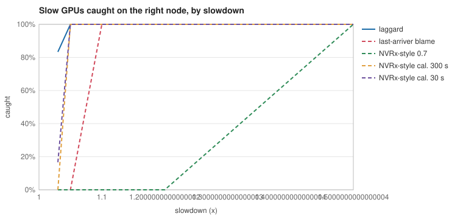
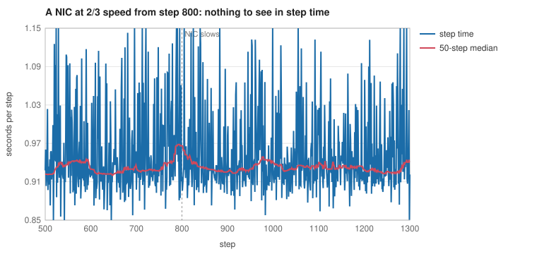

# laggard

Find the one slow GPU, NIC or node in a large training job, say what it is costing the job, and decide whether draining it is worth a restart.

laggard reads the enter and exit times of every collective and pipeline transfer, as each host's own clock saw them. It doesn't need GPU counters, NCCL internals or synchronized clocks. On a simulated 128-GPU job (tensor, pipeline and data parallel) it caught 98% of injected slowdowns on the right node, with a median of 3 steps and no false alarms on 32 healthy runs. The best baseline, last-arriver blame, caught 52%.

## The problem

A training job is only as fast as its slowest member. One GPU running 20% slow, one NIC that renegotiated to a lower speed, one node with a bad fan: the job doesn't crash, it just gets slower. Every other GPU waits at the next collective. These "fail-slow" faults are more common than people expect at scale, and they cost money in a way nobody gets paged for.

Two things make them hard:

1. **Every rank looks equally slow.** A synchronous collective ends at the same moment for every member, so per-rank step time can't tell you who is late.
2. **Finding it isn't the decision.** Draining a node means restarting from a checkpoint, which costs every GPU in the job a few minutes. Whether that's worth it depends on how much the slow part is actually costing the job and how long the job has left. A GPU that's 10% slow may cost the job almost nothing, because some other path is already the slowest.

The usual tools catch the easy half. A step-time alert says something is slow and not what. Comparing each rank's compute with the median (the approach of NVIDIA's Resiliency Extension straggler detector) finds a GPU that is a lot slower than the rest. It can't see a slow NIC at all. Blaming whoever arrives last at each collective finds slow GPUs and gets confused by NICs, because a slow NIC makes all of its group's members late.

## The idea

Four steps, each one cheap. [DESIGN.md](DESIGN.md) has the long version with what goes wrong without each piece.

1. **Split each rank's time into compute and transfer, one clock at a time.** The gap between leaving one operation and entering the next is compute. Inside an operation, the member that arrived last didn't wait, so its time inside is the transfer alone. Both are differences on a single host's clock, so clock offsets and drift between hosts cancel.
2. **Compare each piece with the things that should look the same.** A GPU against the other seven in its node, which run the same layers on the same data. A node against other nodes, after removing replica and stage effects. A data-parallel group against other groups at the same pipeline stage.
3. **A CUSUM per component**, with each step's contribution capped so one long hiccup can't raise an alarm alone, and a cap on how slow the learned normal can be, so a GPU that's slow from step 0 still gets caught.
4. **A NIC is the one in all its slow groups.** A slow NIC makes its data-parallel group and both of its pipeline links slow. Each of its neighbours shares only one of those. So a NIC's score is the lowest score among all its groups.

Then two more for the decision:

5. **Replay the step without the suspect** to get what it cost the job, waiting included. For a GPU at 1.1x, that is 0.0038 s per step against a true 0.0032 s. Charging the GPU's own extra time instead would overstate it about 20 times.
6. **Drain if the cost over the remaining steps beats a restart**, after waiting 50 steps to see if it goes away on its own. With no known horizon, it falls back to ski rental: drain once the slowdown has cost one restart.

## Results

All numbers come from the simulator in `sim/`, which models a 4 x 4 x 8 job (128 GPUs, about 0.96 s per step) with the noise a real job has: data-dependent compute per replica, random hiccups, network congestion, checkpoint pauses, a 1% spread in GPU speed, and clock offset and drift per host. Every detector's thresholds were set on 32 healthy runs to give zero false alarms, then scored on 32 other healthy runs and 84 runs with one fault each.

| detector | caught on the right node | wrong node first | median steps to catch | false alarms on healthy runs |
|---|---:|---:|---:|---:|
| **laggard** | **98%** | 0% | 3 | 0 |
| last-arriver blame | 52% | 0% | 14 | 0 |
| NVRx-style, defaults | 7% | 0% | 271 | 0 |
| NVRx-style, calibrated, 30 s checks | 58% | 0% | 30 | 0 |
| step-time alert | 0% (no location) | | | 1 |

By kind of fault, laggard caught 97% of slow GPUs, 100% of slow NICs, 94% of slow nodes and 100% of transient slowdowns. The only baseline that found any slow NIC was last-arriver blame, at 58%. The two laggard misses were the smallest faults: a GPU 3% slow and a node 5% slow, both present from step 0.



The slow-NIC example shows why reading step time isn't enough. At 2/3 speed the NIC barely moves the step time. laggard named it one step after it slowed down. None of the baselines raised an alarm in the 600 steps after.



**Draining.** Each policy drained the nodes its own alarms named, with a restart costing the job 120 s or 600 s. Regret is the extra job time over an oracle that knows the fault and picks the better of draining immediately or never.

| policy | regret, 120 s restart | regret, 600 s restart |
|---|---:|---:|
| **laggard** | **0.45%** | **0.08%** |
| laggard, ski rental only | 0.92% | 1.45% |
| laggard, drain on first alarm | 3.06% | 19.02% |
| last-arriver blame | 1.19% | 8.00% |
| NVRx-style, defaults | 2.18% | 1.42% |
| never drain | 2.67% | 0.71% |

Draining on the first alarm is worse than never draining. Most of what gets caught isn't worth a restart, and transients end on their own.

**Cost.** Reading one step's trace takes 0.08 ms at 128 GPUs, 0.77 ms at 1024 and 3.4 ms at 4096, about 12 ns per member record, on one core of an Apple M4. Memory is 0.4 MB at 128 GPUs and 12 MB at 4096.

Full tables: [detection](results/detection.md), [ablation](results/ablation.md), [draining](results/decision.md), [example](results/example.md), [cost](results/bench.md).

## Measured vs claimed

| claim | number | where it comes from |
|---|---|---|
| slowdowns caught on the right node | 98% (82 of 84) | `laggard detect`, results/detection.md |
| median steps to catch | 3 | same |
| false alarms on 32 healthy runs | 0 | same |
| slow NICs found without the intersection rule | 29%, down from 100% | `laggard ablate`, results/ablation.md |
| regret against the oracle, 120 s restart | 0.45% | `laggard decide`, results/decision.md |
| replay estimate vs true job cost, GPU at 1.5x | 0.172 vs 0.165 s per step | `TestExcessIsTheJobsCost` in locate/ |
| time to read a 4096-GPU step | 3.4 ms | `laggard bench`, results/bench.md |

Everything is simulated. None of these numbers come from a real cluster.

## Limitations

- **The simulator is mine.** It has the noise I thought of. A real job has more kinds, and the thresholds would have to be set on its own healthy runs.
- **Three kinds of component.** A slow NVLink or a whole slow switch isn't modeled. A switch would make many NICs slow at once, and the intersection rule would blame none of them.
- **Blocking collectives only.** With communication overlapped with compute, the gaps between operations stop being compute and the replay is wrong.
- **One fault at a time.** Two slow parts on different nodes are found and drained one restart at a time.
- **A GPU born more than 5% slow gets flagged.** That's the cap on the learned normal. Set it from the spread of your own hardware.

## Usage

Run the simulator end to end and write every table and chart:

```
go run ./cmd/laggard all -out results
```

The commands one at a time are `detect`, `ablate`, `decide`, `example` and `bench`. `all` takes about five minutes on an M4.

Read a trace and get alarms and drain decisions:

```
go run ./cmd/laggard export -steps 300 -fault gpu:70:1.5:150 > trace.jsonl
go run ./cmd/laggard watch -steps 3000 < trace.jsonl
```

```
step 0: quiet
step 203: GPU 70 on node 8, costing 0.162 s per step
step 252: drain node 8
```

`-steps` is how many steps the job has left in total. Without it, `watch` uses ski rental. `-restart` sets the cost of a restart in seconds (120 by default).

The trace format is JSON lines: a topology line, then one line per step listing each operation's members and their enter and exit times. It's described at the top of `trace/jsonl.go`. To use it on a real job, record those times around each NCCL call and write them out in that format.

As a library:

```go
loc := locate.New(topo, locate.Config{})
for step := range steps {
	loc.Observe(step)
	for _, a := range loc.Alarms() {
		fmt.Println(a.Target, a.Where, a.Node, a.Excess)
	}
}
```

## Running the tests

```
go test -race ./...
go test -bench . ./locate
```

## Layout

```
trace/      operations, steps, topology, and the JSON lines format
locate/     the localizer: residuals, CUSUMs, NIC intersection, replay, drain rule
baseline/   step-time alert, last-arriver blame, NVRx-style scores
sim/        the simulated job, faults, and the experiments
cmd/laggard the command line
results/    what `laggard all` wrote
```

## License

MIT
